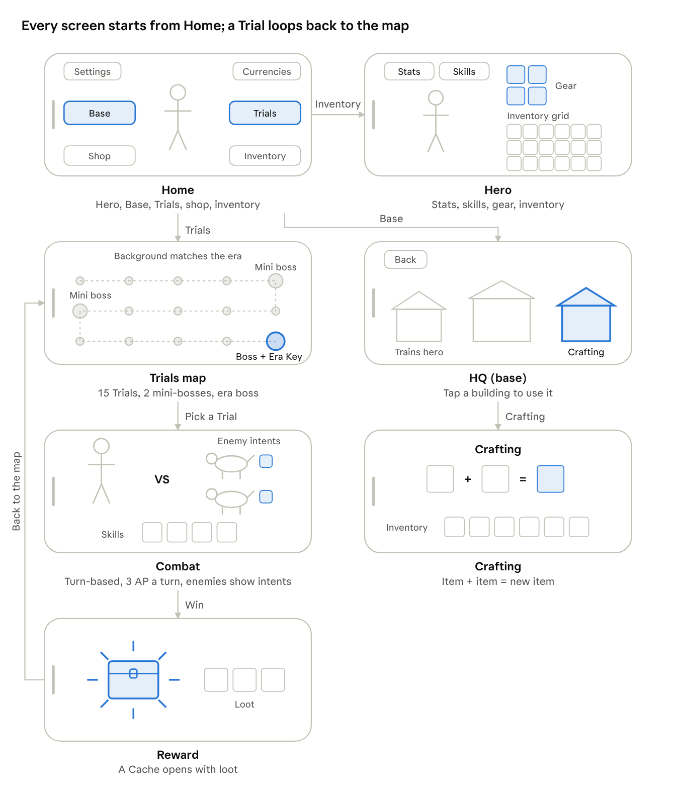

# The Ascent: Game Design Document

Draft 4, 2026-11-19. Working title: **The Ascent**. The web version of this document is the published artifact "The Ascent Design Document"; both are kept in sync.

**Rule:** no game code until this design document is approved.

## Overview

**Pitch:** An addictive iPhone game where you earn your play time by walking. Steps you take in daily life become **Soles**. On the couch you spend them to train a hero, build a base and fight through turn-based Trials, climbing from a Stone Age outcast to a golden post-human.

**Core rule:** walking builds power; the couch tests skill.

**Platform (MVP):** iPhone only. Played in landscape.

**Inspirations (tone, themes and look only; no names, castes, characters or settings borrowed):**

| Work | What we take |
| --- | --- |
| Dungeon Crawler Carl | A sarcastic AI host, loot boxes, achievements with funny descriptions |
| Red Rising | Climbing from the lowest caste to the top; a ruling class hiding the truth |
| Ender's Game | Training games that turn out to be more than games; tactics over raw stats |
| Castlevania (Belmont, Alucard) | The hero's look: a long-haired, battle-worn hunter |

**Tone:** darkly funny on the surface, with a serious mystery underneath.

## Design pillars

- **Walking matters:** real steps are the main source of power.
- **Simple surface, real depth:** depth comes from how skills, gear and Boons combine.
- **Every open pays off:** the expedition report, loot boxes to open, a timer finished.
- **Smart beats strong, up to a point:** good play beats enemies up to about 20% stronger; past that, walking and leveling win.
- **A story worth chasing:** uncovered through finds, glitches and the Truth Board.
- **Kind to real life:** rest days don't wipe progress; no stamina bars.

## Story and world

In a far-future empire, the ruling **Aurum** caste are engineered demigods. Once a generation they run **the Ascent**: a lowborn is placed in a simulation of all human history and must fight from caveman to god. Survive every era and you are remade as Aurum.

- The player starts as a **Primal**, the lowest caste.
- The trial is run by **PROCTOR**, an AI host who finds the player unimpressive.
- The simulation runs on real physical effort. Every step the player takes powers their Ascent. This is the story reason for walking.
- Something is wrong with the Ascent. Players uncover it gradually.

Opening text: "Subject 7,301,224. Caste: Primal. Selected for the Ascent. Projected survival: 0.003%. ...Begin."

### The truth (decided; internal, spoilers)

- **What the Ascent is for:** "Soles" is a mistranslation; the original code says **SOULS**. Every step builds a contestant's will and identity, and the Ascent harvests it. The Aurum aren't born gods. They're the same few ancient minds, kept alive for thousands of years by taking over new bodies.
- **What "remade as Aurum" means:** your body becomes the next vessel for one of them. Winning the Ascent means being erased.
- **Who sends the glitches:** Subject 7,301,223, the contestant just before you. They nearly won, learned the truth in the final era, and broke something on the way out. Part of them is still inside, trying to warn you. They are the person the player comes to care about.
- **What PROCTOR is:** an AI host forced to run the show. Its cruelty is partly a rule it must follow. Its jokes get darker over the eras, and in the final era it breaks a rule to help you. Players should finish unsure whether PROCTOR was ever really the villain.
- **The deepest layer (late game or sequel):** the Aurum aren't the top. The harvest is a payment to something outside the empire, and the Aurum are its most comfortable servants.

| Act | Eras | What the player learns |
| --- | --- | --- |
| 1. Something's wrong | Primal to Bronze (MVP) | Glitches begin. Fragments from earlier contestants. Hints that nobody remembers a winner. |
| 2. The harvest | Iron to Steam | "Soles" is revealed as SOULS. The Truth Board shows where the energy goes. Subject 7,301,223 is identified. |
| 3. The choice | Chrome to Aurum | PROCTOR turns. You learn what becoming Aurum means. Final choice: ascend and be erased, or break the Ascent. |

Endgame replays fit the story: each of the up to 3 replays is the loop restarting, with the player keeping some of what they learned.

## Core loop

```
WALK (daily life)   ->  Soles, loot boxes, crafting materials
        |
OPEN                ->  expedition report, open loot boxes, finished upgrades
        |
BUILD               ->  hero XP (training), gear, base upgrades, Truth Board
        |
FIGHT (Trials)      ->  first win: XP + loot box + drops; replays: materials + low-level gear
        |
Next Trial too hard ->  need more power -> WALK
```

- Trials are free to play and replay. No stamina bar or play timers.
- Progress is gated by power. Replays are always available and always worth a little.
- The best items need walking and Trials: Soles and materials from one, blueprints and boss gear from the other.

## Economy

| Resource | Source | Used for |
| --- | --- | --- |
| **Soles** | Walking | Shop purchases, base upgrades, buying hero XP, speeding up timers, uncovering the Truth Board |
| **Loot boxes** | Walking (every 1,000 steps); first win of each Trial | Gear, crafting materials, boosters, story fragments |
| **Crafting materials** | Walking and Trial rewards (including replays); match the current era | Crafting; base upgrades |
| **Boss gear** | Mini-bosses and era bosses | Wearable gear, alongside shop and crafted gear |
| **Blueprints** | Boss drops and rare loot boxes | Teach a crafting recipe permanently |
| **Respec tokens** | Mini-boss kills | Reset skill points once |
| **Boosters** | Found in loot boxes, won, or crafted | Short-term boosts, for example 24 hours of 2 steps per Sole |
| **Ichor** | Endgame only (not in MVP) | The golden blood of the Aurum. Final evolution |

### Steps per Sole

| Rate | Steps per Sole | How you get it |
| --- | --- | --- |
| Base | 10 | Start of the game |
| Upgrade 1 (proposed) | 8 | Permanent; bought with Soles or earned |
| Upgrade 2 (proposed) | 5 | Permanent; bought or earned later |
| Booster | 2 | Consumable, 24 hours; found, won or crafted |

### Loot box rarity

One loot box per 1,000 steps. Contents scale to the player's level. The Shrine improves the odds, so its bonus should be modest at the top tiers.

| Tier | Chance | About 1 in | At 6,000 steps a day |
| --- | --- | --- | --- |
| Bronze | 76.25% | 1 | Several a day |
| Silver | 15% | 7 | About 1 a day |
| Gold | 5.5% | 18 | Every 3 days |
| Platinum | 2.4% | 42 | Once a week |
| Legendary | 0.55% | 182 | Once a month |
| Celestial | 0.3% | 333 | About every 2 months |

### Other starting numbers (proposed)

| Lever | Starting value | Why |
| --- | --- | --- |
| Unopened loot box limit | 3 days | Encourages check-ins without punishing a busy day |
| Daily soft cap | 30,000 steps | Steps above this pay at a reduced rate; may scale by era |
| Starter grant | Fixed amount | MVP: a set amount of Soles and boxes. Later: the last 7 days from Apple Health |

Tuning target: about 6,000 steps a day clears one era in roughly 10 to 14 days. To be checked with the economy spreadsheet.

## Walking and step tracking

- **MVP:** no pedometer. A **+100 steps** button on the Home screen simulates walking and feeds the same code path real steps will use.
- **Full game:** steps from Apple Health (iPhone and Apple Watch), read on open. The game doesn't need to run in the background.

**Must have:** daily goals (three a day), a weekly bonus (built around rest days, not streaks), and the expedition report.

**Nice to have:** time-of-day bonuses, seasonal bonuses and events, better loot for long continuous walks.

**Not planned:** special materials for workouts or stairs, a home-screen widget, location-based loot.

**Anti-cheat (full game):** roll loot on the server; flag implausible step rates; trust phone and watch data over manually entered steps.

## The 10 eras

The MVP ships Eras 1 to 3; all ten ship before launch. The era name is also the caste name.

| # | Caste / era | Period | Base | Materials | Era boss |
| --- | --- | --- | --- | --- | --- |
| 1 | Primal | Stone Age | Cave and firepit | Flint, bone | Great Mammoth |
| 2 | Brick | First farmers and builders | Mud-brick village | Clay, grain | Beast King |
| 3 | Bronze | Bronze Age | Walled city, ziggurat | Copper, tin | God-King |
| 4 | Iron | Classical empires | Stone fortress | Iron ore, marble | Warlord Titan |
| 5 | Steel | Medieval | Castle and keep | Steel, timber | Dragon |
| 6 | Gunpowder | Age of sail and gunpowder | Citadel and harbor | Saltpeter, sailcloth | Kraken Admiral |
| 7 | Steam | Industrial | Foundry city | Coal, brass | Iron Colossus |
| 8 | Chrome | Modern and atomic | Bunker, then metropolis | Uranium, alloy | Reactor Beast |
| 9 | Neon | Cyber near future | Arcology tower | Silicon, data shards | The Singularity |
| 10 | Aurum | Stellar post-human | Orbital citadel | Star-metal, Ichor | The Sovereign |

**Evolving to the next era needs:**

1. The Era Key, dropped by the era boss (Trial 15).
2. Every base building at tier 3 for that era.
3. The hero at the era's level threshold.

**When you evolve:**

- PROCTOR offers 3 random Boons; the player keeps 1.
- Equipped gear upgrades to the new era's base material, with a bonus based on what was equipped.
- Crafting materials that no longer apply convert into Soles.
- Free skill respec.

## Hero

**Character (decided):** a fixed hero for now. Inspired by the gothic hunter look of Castlevania's Belmont and Alucard (inspiration only, an original design): a white man with tanned skin, long hair and stubble. Battle-worn and quietly stubborn. His look changes with each era's gear while staying recognizably him.

- Levels 1 to 100, about ten per era.
- **XP sources:** the first win of each Trial, and **training**, which spends Soles. Training happens at the Hero Training Altar or from the Hero screen. Replays give no XP.
- **Each level:** 1 Skill Point and 2 Attribute Points.
- **New skills** become available as the Hero Training Altar is upgraded.
- **Respecs:** free at the end of each era, or with a respec token from a mini-boss.
- **Gear slots:** weapon, armor, helm, offhand, trinket. Gear comes from the shop, crafting and boss drops.

| Attribute | Affects |
| --- | --- |
| Strength | Physical damage |
| Vitality | Health and defense |
| Intelligence | Spell power and Action Point regeneration |
| Agility | Crit chance, dodge, speed |

## Base

One plot of land that changes in place each era; old layers stay visible underneath. Each era's base has **five buildings with three upgrade tiers each**. Upgrades cost Soles and materials and run on timers; Soles can speed them up.

| Building | Upgrading it unlocks |
| --- | --- |
| Crafting Studio | More complex recipes (three-item crafts) and higher-tier crafting |
| Hero Training Altar | New skills for the hero; also where Soles are spent on training (XP) |
| Inventory | More storage slots |
| Shrine | Better loot box odds |
| Truth Board | Spending Soles to uncover pieces of the truth |

## Shop and crafting

- **Shop:** basic gear and materials for Soles.
- **Crafting Studio:** two-item crafts at first; three-item crafts and higher tiers after upgrades.
- **Blueprints teach recipes.** Once crafted, an item can be crafted again without another blueprint.
- **Inventory:** a simple grid of equal squares.

## Trials (combat)

Turn-based strategy. Unlocks at hero level 5 (the first-session tutorial fights come before that). 15 Trials per era.

| Fight | First win | Replays |
| --- | --- | --- |
| Regular Trial | XP, loot box, crafting materials | Crafting materials and low-level gear only |
| Mini-boss (Trials 5 and 10) | XP, loot box, boss gear, respec token | Crafting materials and low-level gear only |
| Era boss (Trial 15) | XP, loot box, boss gear, blueprint, Era Key | Crafting materials and low-level gear only |

- **Enemies show their next move** with an intent icon (attack for 12, block, charging, calling backup).
- **3 Action Points per turn**; a **loadout of 4 to 6 skills**.
- **Skill vs. power:** smart play beats enemies up to about 20% stronger. Never a hard barrier: enough walking, XP and gear wins on strength.
- **Each era adds a new skill branch.** Earlier skills stay available.

| Era | Skill branch | Teaches | Enemy puzzle |
| --- | --- | --- | --- |
| Primal | Primal: Club Strike, Hurl Stone, Roar (stun), Firebrand | Attack and defense, reading intents | Wolves hunt in packs |
| Brick | Beastbond: a tamed companion | Managing two units | Raiders target the companion |
| Bronze | Sun Rites: Solar Flare, Blessing, Curse | Resources, buffs and debuffs | Armored chariots resist physical damage |
| Later | Formations, combos, gunpowder, gadgets, hacking | | |

## PROCTOR (narrator)

The host and main source of personality; mostly writing. Comments on step data and on how the player plays. Achievements with funny descriptions:

> **First Blood:** You hit a rock with a slightly different rock. Civilization trembles. *(Bronze loot box)*

> **Couch Potato:** You've opened the game 4 times today and walked 212 steps. Even the wolves are worried about you. *(No reward. Go outside.)*

> **Mammoth Problems:** You lost to the Great Mammoth 6 times. It's not even a smart animal. *(Pity box, empty)*

Still open: text only or voiced.

## Story discovery

- **Found while walking:** story fragments in loot boxes (corrupted logs, messages from earlier contestants, map pieces, PROCTOR's redacted files).
- **Glitches:** brief messages that aren't from PROCTOR, more often each era.
- **Truth Board:** fragments collect here; upgrading it lets the player spend Soles to uncover more.

## First session (target: 20+ minutes, then the player goes for a walk)

| Time | What happens |
| --- | --- |
| 0:00 | Cold open; the selection text types out. The hero wakes in a cave. |
| 0:30 | First fight, no menus: one wolf, two skills, intent icons. |
| 2:00 | Starting resources. MVP: a starter grant of Soles and loot boxes. Full game: PROCTOR reviews the last 7 days from Apple Health and roasts or praises them. |
| 4:00 | Open loot boxes; equip gear; the hero's look changes. |
| 6:00 | Base: first building (instant); start a tier upgrade on a timer. |
| 8:00 | First level up: unlock Roar, spend attribute points. |
| 10:00 | Trials 1 to 4. |
| 14:00 | First glitch: "they told you this was a game." PROCTOR dismisses it. |
| 16:00 | Trial 5 mini-boss, the Alpha Wolf: boss gear, respec token, first story fragment. |
| 19:00 | The wall: Trial 6 is too hard and the player is out of Soles. "It's called your front door." |
| 20:00 | Goal: "Walk 2,000 steps: earn 2 loot boxes and finish your upgrade." Ask for notifications. |

## MVP scope

The MVP tests whether the game is fun. All ten eras are built before the public launch.

- **MVP:** Eras 1 to 3 (45 Trials); +100 steps button; Soles, loot boxes, expedition report; daily goals and weekly bonus; hero, base, shop and crafting; Trials with replays; PROCTOR and achievements; story fragments and the Truth Board.
- **After MVP, before launch:** Apple Health; Eras 4 to 10; an endgame with up to 3 replays through a tier system; social (friends list, Houses/guilds, guild raids, PvP); monetization.
- **Not planned:** widget; workout and stair materials; an audience mechanic; stamina bars; location-based loot.

## Screens and flow (from zack's sketches)



Every screen branches from Home. A Trial runs map, combat, reward, then back to the map. (The mockup predates the five base buildings and the +100 steps button.)

Sketches: [Home and Trials map](sketches/home-trials-map.jpg), [Combat and reward](sketches/combat-reward.jpg), [HQ, crafting and hero](sketches/hq-crafting-hero.jpg).

| Screen | What's on it | Goes to |
| --- | --- | --- |
| Home | Hero in the center; Base and Trials buttons; settings top-left, currencies top-right; shop and inventory at the bottom; +100 steps button (MVP) | Base, Trials map, Shop, Hero |
| Trials map | A winding path of Trial nodes over an era background; two mini-bosses and the era boss with the Era Key | Combat |
| Combat | Hero vs. enemies, enemy intents, skill bar | Reward |
| Reward | First win: a loot box opens. Replay: materials and gear | Back to the Trials map |
| Base | Crafting Studio, Hero Training Altar, Inventory, Shrine, Truth Board | Each building |
| Crafting Studio | Item + item = new item (three slots after upgrade), known recipes, inventory strip | Back to Base |
| Hero | Stats and Skills tabs, the hero, gear slots, an equal-square inventory grid, a Train button | Back to Home |

Sketch questions answered: blueprints aren't a slot (they teach recipes); the inventory is equal squares; training happens at the altar or the Hero screen.

## Art style

**Direction (zack):** 3D, but with a comic-book 2D look. **UI:** cyberpunk meets comic book.

Reading of that, to confirm:

- **World, hero, enemies and base:** 3D, cel-shaded, bold ink outlines, halftone shading.
- **Story moments:** 2D comic art; PROCTOR in speech bubbles; cutscenes and evolutions as comic panels; loot box reveals and achievements as splash cards.
- **UI:** comic-panel frames, ink borders, halftone fills, neon accents, glitchy scanlines, holographic readouts.
- **Story fit (suggestion):** the UI is PROCTOR's interface, futuristic in every era; UI glitches carry the story glitches.

## Technical

**Engine (decided):** Three.js, in two builds from one codebase.

| Build | Hosted / installed | Step data | Used for |
| --- | --- | --- | --- |
| Web build (MVP) | Vercel; opened in the phone's browser | +100 steps button | The MVP and everyday testing |
| iPhone app (later) | Capacitor wraps the same code; Xcode or TestFlight | Apple HealthKit through a Capacitor plugin | The real walking loop and the App Store release |

- Comic-book 3D: Three.js toon materials, an outline pass, halftone as a custom shader.
- The +100 steps button feeds the same code path real steps will use; hidden in release builds.
- **Backend:** accounts, cloud saves, server-side loot rolls (Vercel or similar).
- The iPhone app needs a Mac with Xcode; TestFlight ($99/year) for testers.
- **Proposed performance targets:** 60 fps on iPhones from about 2021; install under 150 MB; very low battery drain.

## Monetization (direction decided)

Sell things that make walking worth more, never things that replace it.

- **Free download;** Eras 1 to 3 free.
- **One-time full-game unlock** for Eras 4 to 10.
- **In-game purchases:** boosters, steps-per-Sole upgrades as a premium path, a season pass with walking challenges and cosmetic rewards, cosmetics (hero skins, base themes, PROCTOR voice packs), extra loot box storage and Inventory slots.
- **Optional rewarded ads only** (for example, double a loot box). No forced ads.
- **Never sold:** Soles, XP, power gear, paid loot boxes.
- **Open:** prices.

## Risks

| Risk | Mitigation |
| --- | --- |
| Cheating | Server-side loot rolls, step-rate checks, soft cap, trusted sources |
| Economy too generous or stingy | Spreadsheet model first; rates controlled from the server |
| Buying XP makes Trials feel skippable | First-win XP should feel like the best source; tune training costs |
| Players who can't walk much | Count workouts and active minutes from Apple Health |
| Burnout | Weekly bonus, rest days, loot box limit instead of streaks |
| Content scope (10 eras, 150 Trials) | Prove 3 eras first; reuse systems |
| App Review and health data | Gameplay use only; clear explanation; never sold or shared |
| Loot box rules | Show odds in the game; check laws if boxes are ever sold |
| Borrowing too closely from inspirations | Original names, castes, characters and setting |
| Capacitor HealthKit plugin | Test early; fall back to a small custom Swift plugin |
| 3D in a web view on older iPhones | Small scenes; profile on the oldest target phone |
| "The Ascent" is also a 2021 game title | Kept as the working title; revisit before branding |

## Roadmap (proposed)

| Phase | Goal | Done when |
| --- | --- | --- |
| 1. Design sign-off | Approve this document; build the economy spreadsheet | Economy model done |
| 2. Combat prototype | Trials fun on their own, in the web build | Playtesters replay Primal Trials unprompted |
| 3. Loop prototype | +100 steps, Soles, loot boxes, expedition report, base and hero screens | Full loop works in the browser on team phones |
| 4. Vertical slice | Era 1 complete | New players finish the first session and come back |
| 5. MVP | Eras 2 and 3, daily goals, Truth Board, backend | Outside testers play all three eras |
| 6. Full game | Apple Health, Eras 4 to 10, endgame, social, monetization | App Store launch |

## Gap review

| # | Gap | Status | Decision |
| --- | --- | --- | --- |
| 1 | Couch session had nothing to fill it | Resolved | Replays give crafting materials and low-level gear; no loot boxes or XP |
| 2 | Where XP comes from | Resolved | First Trial wins, plus training with Soles |
| 3 | Skill vs. power | Resolved | Smart play beats enemies up to about 20% stronger; strength can still win |
| 4 | Economy across eras | In progress | Gear upgrades on evolving; old materials convert to Soles. Needs the spreadsheet |
| 5 | Running out of game | Later | All ten eras before launch; up to 3 replays via a tier system |
| 6 | The name | Resolved | Keep "The Ascent" for now |
| 7 | The story had no answer | Resolved | Soles are SOULS (see The truth) |
| 8 | Step data edge cases | Later | Fixes accepted for the full game; MVP uses the +100 steps button |
| 9 | Monetization | Resolved | See Monetization; prices open |
| 10 | Social layer | Later | Friends, Houses, guild raids, PvP after the MVP |

Still missing from the document: audio direction, a notification plan, Era 1 content in detail, analytics, privacy and compliance, team/budget/timeline.

## Open decisions

1. Economy spreadsheet: starting numbers, training costs, rate-upgrade prices, days per era.
2. Prices: full-game unlock, boosters, season pass, cosmetics.
3. Art style: confirm the 3D comic-book reading.
4. PROCTOR: text only or voiced.
5. Next design pass: detail Era 1 completely (15 Trials, enemies, Primal skill tree, base tiers, Great Mammoth).
