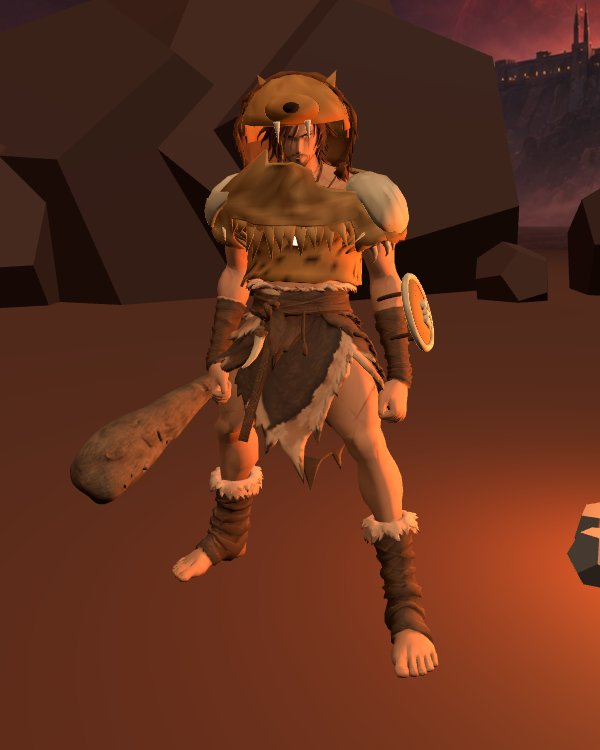

# Wearables on the caveman hero

The 19 Era 1 wearables (armor, helm, offhand, trinket) now show on zack's rigged caveman. This first pass was modelled in Blender from code (`tools/wearables/`) to fit his body exactly; the plan is to replace each one with zack's own art (ChatGPT reference, then Tripo) using the prompts below. Weapons are not in this pass: the hero still always holds zack's club.



Contact sheets of the first pass (two views each, on the hero's T-pose):
[armor](art/wearables/armor.jpg) · [helm](art/wearables/helm.jpg) · [offhand](art/wearables/offhand.jpg) · [trinket](art/wearables/trinket.jpg)

## How it works in game

- One file per item: `public/models/gear/<itemId>.glb` (the item ids are the keys of `GEAR` in `src/data/era1.js`).
- The files are **not rigged**. `src/scene/wear.js` skins them onto the hero's own skeleton when they're equipped, so they follow every animation clip:
  - a mesh (or a parent node) whose name ends in `__<Bone>` rides that bone rigidly. Helms use `__Head`, shields use `__LeftForeArm`.
  - every other mesh copies the skin weights of the nearest hero vertices. Armor and necklaces work this way, so they bend with the chest, shoulders and neck.
- Only items listed in `WEARABLES` (top of `wear.js`) are shown. Equipping anything else in a slot leaves that slot bare on the hero.

## Swapping in a new model (for example, a Tripo GLB)

1. Open Blender and import `public/models/caveman.fbx`. It comes in standing in his **bind pose (T-pose)**, about 0.86 m tall, feet at 0, facing -Y. That's the space every gear file uses. (The game matches the files to the hero by joint positions, so this has to stay the same.)
2. Import the new item, then move, scale and rotate it until it sits on him: armor hugging the torso, helm on the hair, shield on top of the **left forearm** (that side faces outward when his arm hangs), necklaces on the neck and chest.
3. For a helm or shield, name the object `<itemId>__Head` or `<itemId>__LeftForeArm`. Leave armor and trinkets with any other name.
4. Delete the caveman, select the item and export **glTF Binary (.glb)** with "+Y Up" on, "Apply Modifiers" on, and no skin or animation. Save it over `public/models/gear/<itemId>.glb`.
5. Keep it light: under about 300 KB and 10k triangles per item. Tripo exports are usually much bigger, so decimate them first. Meshopt-compressed files (gltfpack) load fine; Draco does not.

To rebuild the current first pass: `pip install bpy`, then `python tools/wearables/items.py` (or `python tools/wearables/items.py -- hide_wrap skull_cap` for some items). It writes the GLBs and renders two views of each to `tools/wearables/shots/`.

## ChatGPT reference prompts

**Attach these to every request:** a front screenshot of the caveman in his T-pose (or `docs/art/wearables/<slot>.jpg`) so the size and fit match. Say "sized to fit the attached character".

**Shared style block (paste first):**
```
Game asset concept for a 3D model. Era: Stone Age, Primal era of a mobile RPG. Style: painterly stylized realism matching the attached caveman hero (anime-influenced faces, chunky readable shapes, hand-painted texture detail, warm natural colours). Show the single item on its own, centred, in a 3/4 front view with a matching back view beside it. Plain light-grey background, soft even studio lighting, no character, no mannequin, no text, nothing cropped. Sized and shaped to fit the attached hero: a tall, very muscular man with broad shoulders, a narrow waist and a big mane of spiky dark-brown hair.
```

Each item adds one prompt after the style block. The "fit" line says where it sits on him, which matters for Tripo.

### Armor (sits on the torso from the belt to the base of the neck; his arms stay bare)

**torn_hide** · Torn Hide (worn)
```
A ragged, sleeveless hide wrap for the chest, sun-faded grey-brown leather full of holes and tears, with a frayed hem and a thin cord knotted across the stomach. One shoulder is torn away. Cheap, used and patched. Fit: wraps the chest and stomach and stops at a belt line; open at the arms.
```

**hide_wrap** · Hide Wrap (shop)
```
A sleeveless tan rawhide vest wrapped around the chest, with criss-cross leather lacing up the front, a strap over one shoulder and a thin cord belt at the hem. Clean, simple and newly made. Fit: hugs the chest and stomach from the belt to the neck; open at the arms.
```

**bone_mail** · Bone Mail (crafted)
```
A dark leather vest covered in overlapping rows of small polished bone plates, like scales, front and back, with rounded bone shoulder caps. Ivory bone on dark brown leather. Fit: hugs the chest and stomach from the belt to the neck; the shoulder caps sit on top of the shoulders; arms bare.
```

**wolf_pelt** · Wolf Pelt (crafted, Pack Hunter set)
```
A grey wolf pelt worn as a thick fur mantle over the shoulders, with a shaggy ragged fringe hanging over the chest and back, over a dark leather vest. Grey fur with darker tips, maybe a small wolf ear at one shoulder. Fit: the mantle sits on the shoulders and upper chest; the vest covers the stomach to the belt; arms bare.
```

**sabre_hide** · Sabretooth Hide (boss drop, Predator set)
```
A trophy cuirass made from a sabretooth cat: tawny spotted hide over the chest and stomach, a heavy tawny fur mantle on the shoulders, bone shoulder plates and two huge curved sabre fangs hanging from the front of the shoulders. Imposing and rare-looking. Fit: covers the torso from the belt to the neck; mantle and plates on the shoulders; arms bare.
```

### Helm (sits on top of his big hair, above the eyes; the face stays clear)

**skull_cap** · Skull Cap (shop)
```
The top of an animal skull worn as a cap, weathered off-white bone with a row of small teeth along the front rim and a thin leather chin cord. Fit: a dome over the top of the head and hair; the front edge sits above the eyebrows.
```

**bone_helm** · Bone Helm (crafted)
```
A sturdy helm carved from a large bone dome, with a raised bone band around the brow and two horns curving up and out from the sides. Ivory bone with darker cracks. Fit: a dome over the top of the head and hair; front edge above the eyebrows; face open.
```

**lion_mask** · Lion Mask (crafted, Predator set)
```
A cave-lion hood: the lion's upper head worn over the hero's head, tawny fur, small rounded ears, the muzzle and nose over the forehead with two white upper fangs, and a shaggy darker mane falling down the back of the neck. Fit: over the top and back of the head; the lion's muzzle sits on the forehead above the eyes; face open.
```

**storm_crown** · Storm-Eye Crown (rare)
```
A primitive crown: a band of pale antler bone circling the head with a row of short antler tines standing up across the front, tallest in the middle, and a glowing pale-blue storm stone set in the front. Mystic and rare. Fit: rests on the hair around the forehead and temples.
```

### Offhand (strapped to the outside of his left forearm with two leather straps, faces outward)

**bark_shield** · Bark Shield (shop)
```
A round shield made from a slab of thick bark, slightly domed, rough wooden rim, two leather lashings crossing the face, and two forearm straps on the back. Fit: about as wide as his forearm is long; strapped flat to the outer forearm.
```

**flint_buckler** · Flint Buckler (crafted)
```
A small round wooden buckler covered in tan hide, with a knapped flint boss in the centre and a ring of sharp flint shards studded around the rim, and two forearm straps on the back. Fit: a bit smaller than his forearm is long; strapped to the outer forearm.
```

**claw_buckler** · Claw Buckler (crafted, Predator set)
```
A small round buckler faced with spotted tawny cat hide, an ivory bone rim, and three big dark curved claws fanning out from the centre, with two forearm straps on the back. Fit: a bit smaller than his forearm is long; strapped to the outer forearm.
```

**obsidian_ward** · Obsidian Ward (rare)
```
An oval shield set with glossy black obsidian shards in a wooden frame, the shards catching purple-violet glints along their edges, with a faint violet glow at the rim and two forearm straps on the back. Rare and menacing. Fit: about as wide as his forearm is long; strapped to the outer forearm.
```

### Trinket (a cord around the neck hanging to mid-chest, below his own tooth necklace)

**pebble_string** · Pebble String (worn)
```
A simple leather cord necklace threaded with nine smooth river pebbles in grey and brown. Cheap and plain. Fit: around the neck, the pebbles resting on the upper chest.
```

**tooth_charm** · Tooth Charm (shop)
```
A leather cord necklace with three animal teeth hanging from the front, the middle tooth longest. Fit: around the neck, the teeth hanging to the middle of the chest.
```

**ember_stone** · Ember Stone (shop)
```
A leather cord necklace with a rough oval stone wrapped in cord, glowing orange from within like a live ember. Fit: around the neck, the stone hanging to the middle of the chest.
```

**fang_charm** · Fang Charm (crafted, Pack Hunter set)
```
A leather cord necklace with one big curved wolf fang hanging at the front and alternating dark and bone beads along the cord. Fit: around the neck, the fang hanging to the middle of the chest.
```

**ember_totem** · Ember Totem (crafted)
```
A leather cord necklace with a small carved bone totem figure, banded with two rings, with tiny glowing ember eyes and a glowing ember set in its chest. Fit: around the neck, the totem hanging to the middle of the chest.
```

**ghost_amber** · Ghost Amber (rare)
```
A leather cord necklace with a teardrop of clear honey amber glowing a pale ghostly gold, capped in bone, with small bone beads along the cord. Rare and mystic. Fit: around the neck, the amber hanging to the middle of the chest.
```
